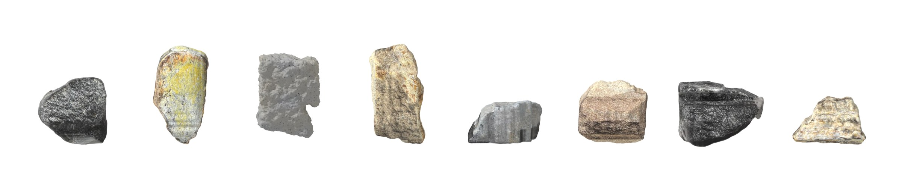
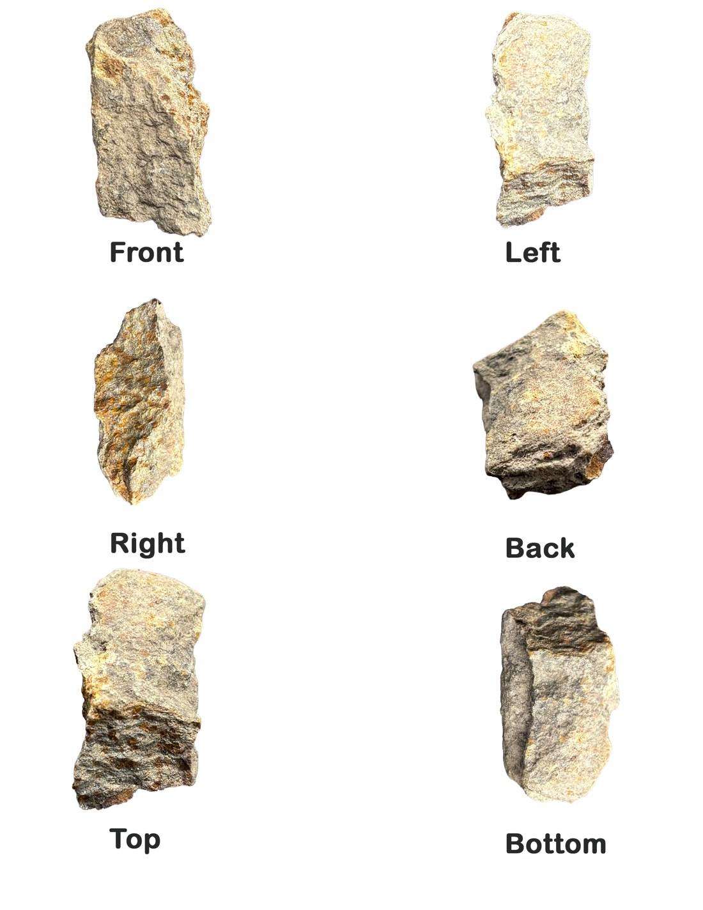
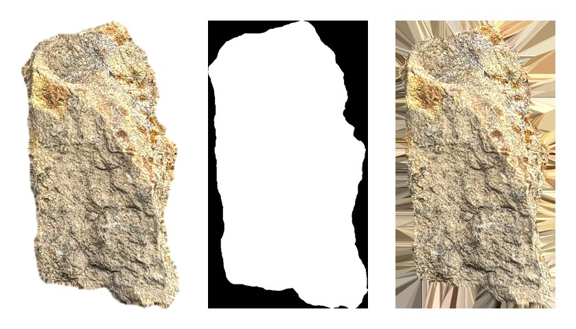
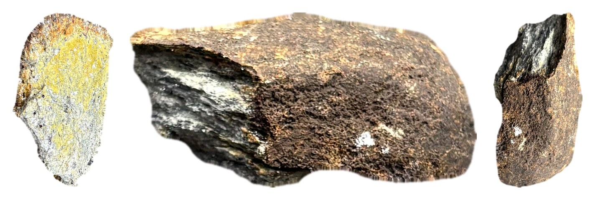
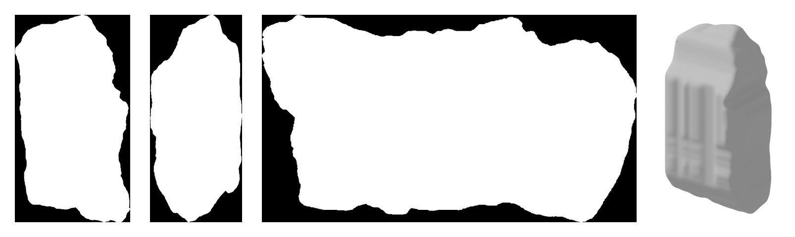
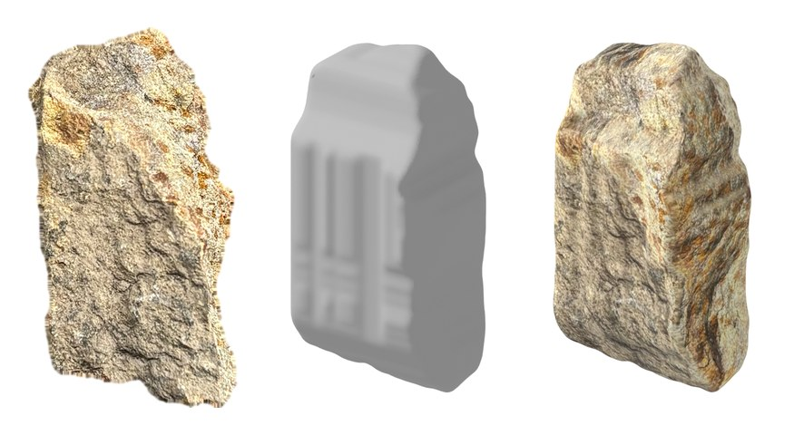

# Rock Remaker

Turn a sheet of six photographs of a rock into a turning 3D object for the web:
the outlines carve the shape, and the photographs wrap back around it as its
surface. Built for [Metamorphosis](https://kyruaaaa.github.io/metamorphosis/), a
clock of rocks transformed by heat, where seven of the eight specimens were
remade this way ([site code](https://github.com/Kyruaaaa/metamorphosis)).



## Quick start

Needs **Blender 4.x** and **Python 3** with `numpy`, `scipy`, `pillow` and
`scikit-image`.

```bash
./remake.sh path/to/sheets path/to/models
```

Every `NAME.png` sheet becomes `NAME.glb` (the rock) and `NAME_ghost.glb` (the
same rock as glass with an irregular wireframe), in about five seconds each.
Previews to check against your photos land in `work/NAME/preview_*.png`.

## How it works

### 1 · Photograph six sides

Front, left, right, back, top and bottom, each on pure white, laid out as a
2 × 3 grid with the label under each photo. Front plus one side is enough;
the top is used when it's there.



### 2 · Cut each view out — `scripts/cutout_views.py`

Anything not pure white is rock; dust is dropped, holes filled, and only the
one big piece kept. Each view becomes an outline and a photo whose background
is filled with the rock's own edge colours, so no white bleeds onto the model.



### 3 · Turn the views upright — `scripts/build_hull.py`

Rocks get turned in the hand between shots. A side view whose *width* matches
the front's height better than its own height was taken lying down, and is
turned 90°. Near-square views are only turned when the match is clearly better.



### 4 · Carve the shape — `scripts/build_hull.py`

A block of tiny cubes (128 along the longest side) is cut by the front outline
from the front, the side outline from the side and the top outline from above;
only cubes inside all three survive. No top photo → a rounded cross-section.
The result is softened like weathered stone, meshed, and scaled so every rock
has the same overall size.



### 5 · Wrap the photographs back on — `scripts/build_rock.py`

In Blender, each photo is projected onto the shape from the direction it was
taken; each patch of surface takes the photo facing it most squarely, blending
where two meet. Missing top/bottom photos borrow the front/back. The photos'
grain also becomes a bump map. Everything is baked into a colour texture and a
normal map (1024 px) on a ~30,000-face mesh and exported as one `.glb`.



### 6 · The after-kiln ghost — `scripts/make_ghost.py`

The same shape as a faint glass shell inside an irregular wire net: rebuilt on a
grid, every point nudged, some edges dissolved, then snapped back onto the real
surface so the lines follow every bump.

## Other rocks

- `scripts/tuff_generator.py` — a rock described entirely in a Blender script
  (a wedge cut by hidden boxes and spheres, roughened, with a procedural porous
  material). Export it with `scripts/export_glb.py`, which applies every
  modifier and bakes the material so the `.glb` matches what Blender shows.
- `scripts/lava_generator.py` — small black scoria: a lumpy body covered in
  cupped gas-bubble hollows, a different shape per seed.

```bash
Blender -b --factory-startup --python scripts/lava_generator.py --python scripts/export_glb.py -- lava.glb 512 LavaRock -- 3
```

## What it guesses

Outlines and photographs are the real rock; what no view shows is inferred.
Hollows and undercuts get filled in, views taken with the rock turned
differently make the carving a best guess, and a shadow left in a cutout
becomes part of the rock. A photogrammetry or 3D-scanning app captures hidden
sides exactly, and its files can be used in the same way.

## Tuning

| Setting | File | Effect |
| --- | --- | --- |
| `RES` | `build_hull.py` | carving detail (cubes along the longest side) |
| `SMOOTH` | `build_hull.py` | how rounded the carved edges are |
| `SIZE` | `build_hull.py` | every rock's overall size (bounding-box diagonal) |
| `TEXTURE_SIZE`, `TARGET_FACES` | `build_rock.py` | texture resolution, mesh detail |
| `WIRE_CELL`, `JITTER`, `DISSOLVE` | `make_ghost.py` | the wire net's cell size and irregularity |
| `WIRE_THICKNESS`, `GLASS_ALPHA` | `make_ghost.py` | line weight, glass visibility |

`SKILL.md` describes the same process for Claude, so it can run and adjust it
for you.
