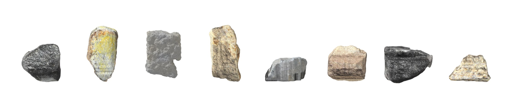
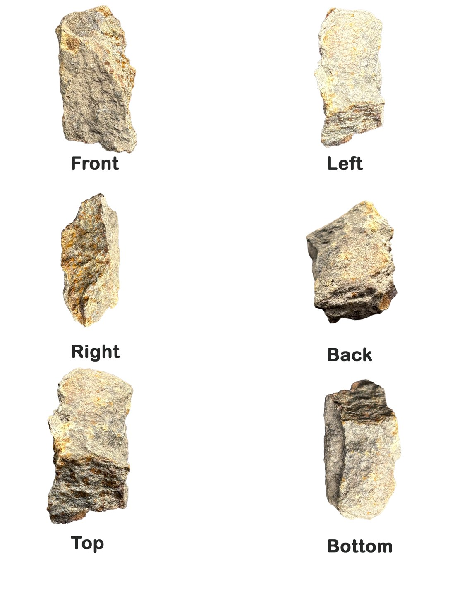
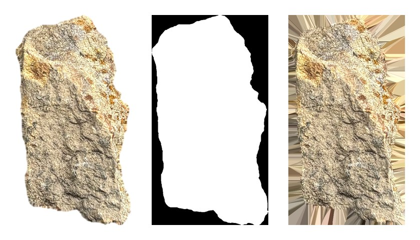
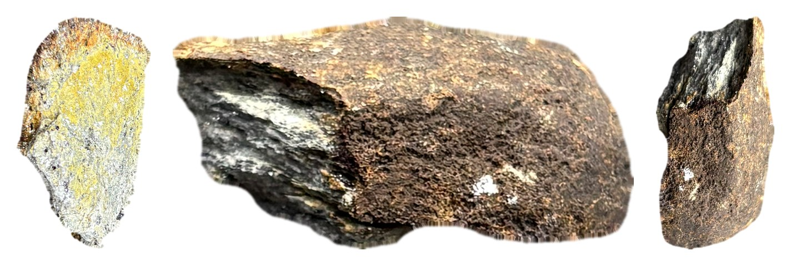
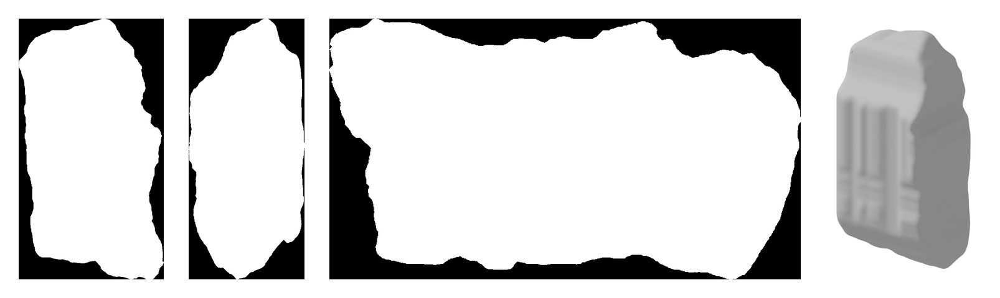
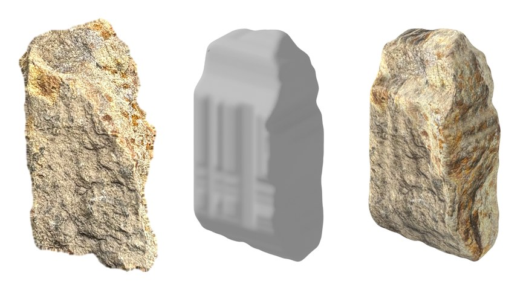

# Rock Remaker

Turn a sheet of six photographs of a rock into a turning 3D object for the web:
the outlines carve the shape, and the photographs wrap back around it as its
surface. Built for [Metamorphosis](https://kyruaaaa.github.io/metamorphosis/), a
clock of rocks transformed by heat, where seven of the eight specimens were
remade this way ([site code](https://github.com/Kyruaaaa/metamorphosis)).



## Quick start

Needs **Blender 4.2 or newer** (tested on 4.5) and Python 3:

```bash
pip install -r requirements.txt
./remake.sh examples out
```

The source folder can hold photo sheets (`NAME.png` or `NAME.jpg`), subfolders of
photos, or be one folder of photos named `front`, `back`, `left`, `right`, `top`
and `bottom`. Hand-held phone photos work: the rock is separated from the room by
sharpness, position and colour, and fingers are removed from its outline.

Each rock gives `NAME.glb` and `NAME_ghost.glb` (the rock as glass with an irregular
wireframe), and `work/NAME/report.png`, which sets every photo beside the matching
render, with warnings. One bad rock doesn't stop the batch, and an existing model is
only replaced after a successful build.

If a photo is turned the wrong way, add `work/NAME/overrides.json`, such as
`{"rotate": {"top": 180}}`, with clockwise degrees.

The `.glb` files use Draco mesh compression and WebP textures. `<model-viewer>`
fetches its Draco decoder from Google's CDN unless you host it yourself.

## How it works

### 1 · Photograph six sides

Front, left, right, back, top and bottom, each on pure white, laid out as a
2 × 3 grid with the label under each photo. Front plus one side is enough;
the top is used when it's there.



### 2 · Cut each view out — `scripts/cutout_views.py`

On a pure white sheet, anything not white is rock. For ordinary photos the rock
is found by being sharp, central and differently coloured from the room. Each view
becomes an outline and a photo whose background is filled with the rock's own
colours, so no room or white bleeds onto the model.

When the room is in focus or cluttered, `MATTE=rembg ./remake.sh …` uses a trained
background remover instead (`pip install "rembg[cpu]"`). Hands are cut away by colour,
and thin things the remover keeps with the rock, like a pole or a cable, are trimmed
off. For a green or grey rock held in a pale hand, add `SKIN_A=5` so the whole palm
counts as skin.



### 3 · Turn the views upright — `scripts/orient.py`

Each view may be turned by any quarter turn. Opposite views should mirror each other,
neighbours should share colours along their edge, and a top view fixes the width
to depth ratio. Close calls are listed in the report.



### 4 · Carve the shape — `scripts/build_hull.py`

Each outline carves a soft volume: sharp near the middle of the rock along its
viewing direction, relaxing further away, so that a bump on one outline isn't
dragged across the whole rock as a groove. With no top photo, every height gets a
rounded cross-section fitted to it. Optional extras: corner photos (`front_left`,
`front_right`, `back_left`, `back_right`) carve at 45°, and `RELIEF=1` presses shallow
hollows in from estimated depth (`pip install torch transformers`; about 1 GB). It helps
rough, faceted rocks most and does little on smooth ones. Check the clay preview: a
dark patch in a photo is not always a real dent.



### 5 · Wrap the photographs back on — `scripts/prepare_textures.py`, `scripts/build_rock.py`

The room's broad light is reduced and exposure matched between views. Each photo is
projected from the direction it was taken, and each patch of surface takes the photo
facing it most squarely. Missing top or bottom photos are made from the mirrored end
of the front photo, and a missing back or side borrows the opposite photo. The
photos' fine grain, not their colour patches, becomes the normal map.

For rocks with mica or other glinting flakes, `ROCK_ARGS="--sparkle 0.12 --texture 2048"`
scatters small, smooth, randomly tilted flakes over the surface and bakes them into a
roughness map, so they catch the light as the model turns in any glTF viewer.



### 6 · The after-kiln ghost — `scripts/make_ghost.py`

The same shape as a faint glass shell inside an irregular wire net: rebuilt on a
grid, every point nudged, some edges dissolved, then snapped back onto the real
surface so the lines follow every bump.

## Other rocks

- `scripts/tuff_generator.py` — a rock described entirely in a Blender script
  (a wedge cut by hidden boxes and spheres, roughened, with a procedural porous
  material). Export it with `scripts/export_glb.py`, which applies every
  modifier and bakes the material so the `.glb` matches what Blender shows.
- `scripts/lava_generator.py` — small black scoria: a lumpy body covered in
  cupped gas-bubble hollows, a different shape per seed.

```bash
Blender -b --factory-startup --python scripts/lava_generator.py --python scripts/export_glb.py -- lava.glb 512 LavaRock -- 3
```

## What it guesses

Outlines and photographs are the real rock; what no view shows is inferred.
Hollows are only there if depth estimation is on, hand-held photos are treated as if
taken from straight on, and hidden parts of the outline are restored from the
rock's overall shape. A photogrammetry or 3D-scanning app captures hidden sides
exactly, and its files can be used in the same way.

## Tuning

Every step takes options; run a script with `--help`, or pass them to Blender after
`--`. The main ones:

| Option | Script | Effect |
| --- | --- | --- |
| `--res`, `--smooth` | `build_hull.py` | carving detail, final softness |
| `--soften`, `--blend` | `build_hull.py` | outline relaxing, corner rounding |
| `--size` | `build_hull.py` | every rock's overall size |
| `--delight` | `prepare_textures.py` | how much of the photos' lighting is removed |
| `--texture`, `--faces`, `--blend-power` | `build_rock.py` | texture size, mesh detail, width of photo blends |
| `--wire-cell`, `--jitter`, `--dissolve` | `make_ghost.py` | the wire net |
| `--wire-thickness`, `--glass-alpha`, `--glass-faces` | `make_ghost.py` | line weight, glass |

Tests: `python3 -m pytest tests`.

`SKILL.md` describes the same process for Claude, so it can run and adjust it for you.
